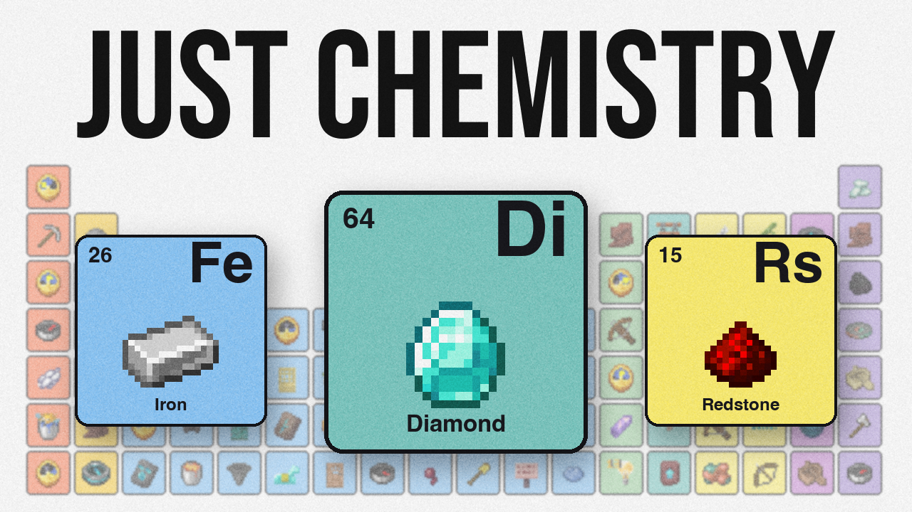
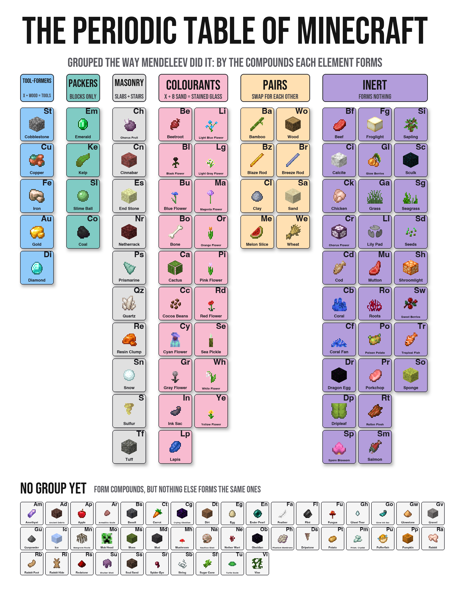

<div align="center">

# The Periodic Table of Minecraft

**I went through every recipe in Minecraft and built it its own periodic table, the same way Mendeleev built the real one.**

[](https://youtube.com/watch?v=VIDEO_ID)

<sub>Click the thumbnail to watch the video.</sub>


</div>

## What this is

So, this is the code and data behind my video on Minecraft's crafting being secretly chemistry. Everything in the table comes straight out of the game's own files: every recipe, every loot table, every tool stat. I didn't hand pick any of the groups. The code just looks at what each element combines into and the groups show up on their own.

It took way longer than I'd like to admit, so I figured I'd put it all here in case anyone wants to check my work or mess around with it.

<div align="center">



</div>

## The short version

- **Cobblestone and diamond are in the same group.** They both make every tool with two sticks in the exact same shapes, so as far as the chemistry goes they're basically the same kind of element. Which is kind of funny when you think about how hard one of them is to find.
- **A snowball is a building stone.** Four snowballs make a snow block, three snow blocks make snow layers, and that's the same pattern quartz, end stone and netherrack follow.
- **An emerald is basically kelp.** Emerald, kelp, slime balls and coal only ever do one thing: pack nine into a block and unpack it back. They never go into a recipe with anything else.
- **Raw meat is Minecraft's noble gases.** 28 elements never combine with anything, and almost every raw meat and fish is in there, plus rotten flesh, coral and the dragon egg.
- **It predicted copper tools.** Copper used to be the only metal with no tools, which left a hole in the tool group between stone and iron. So I did what Mendeleev did and averaged the neighbours:

| Stat | Stone | Iron | Predicted | Real copper |
|---|:---:|:---:|:---:|:---:|
| Durability | 131 | 250 | **190.5** | **190** |
| Mining speed | 4 | 6 | **5** | **5** |
| Attack damage bonus | 1 | 2 | 1.5 | 1 |
| Enchantability | 5 | 14 | 9.5 | 13 |

Copper tools showed up in the Copper Age update (Java 1.21.9, September 2025). Durability and speed landed pretty much exactly where the table said they would. Damage was a little off and enchanting was way off, but Mendeleev's guesses weren't perfect either.

## How the elements were picked

An element is basically anything you can't make out of something simpler. So every item gets broken down recipe by recipe until it hits stuff no recipe can make. That gave me 257 things, which is way too many, so I set a few rules and applied them to everything the same way:

1. **It has to come from nature.** Block drops, mob drops, fishing. Not chest loot.
2. **It's whatever lands in your hand.** Mining diamond ore gives you a diamond, so the diamond counts and the ore doesn't.
3. **Nobody made it.** Bells, potions and music discs are out even though you can find them in the world.
4. **It isn't just something else that changed.** Dead coral is just coral that died.

Then isotopes: if a recipe takes any of the twelve log types, those twelve logs share one box. Flowers only share a box when they make the same dye. After all that I had 118 elements. You can see every one, and what's in each box, in [`results/elements.json`](results/elements.json).

## How the groups work

Mendeleev figured out that you shouldn't group elements by what they look like. You group them by what they combine into. Sodium and potassium both mix with chlorine and make basically the same thing, so they go together.

So I took every recipe in the game and blanked out one ingredient. A pickaxe is three of something plus two sticks. Then I checked what else fits in that blank. If two elements keep fitting the same blanks across a bunch of recipes, they're in the same group.

| Group | Elements | What they share |
|---|:---:|---|
| Tool-formers | 5 | X plus two sticks makes every tool |
| Masonry | 10 | three in a row makes a slab, four in a square makes a block, then stairs |
| Colourants | 19 | eight sand around X makes stained glass |
| Packers | 4 | nine pack into a block and that's it |
| Pairs | 4 pairs | wood and bamboo, blaze rods and breeze rods, sand and clay, wheat and melon |
| Inert | 28 | never go into a single recipe with anything else |
| No group yet | 44 | combine with stuff, but nothing else combines the same way |

Mendeleev had leftovers he couldn't place too, so I didn't feel too bad about the 44. The full list is in [`results/groups.json`](results/groups.json).

## Run it yourself

You need Python 3.10+ and your own copy of Minecraft (no game files are included here).

```bash
pip install -r requirements.txt
python extract.py ~/.minecraft/versions/26.3/26.3.jar   # point this at your own client jar
python elements.py && python groups.py && python predict.py
python render.py
```

On Windows the jar is usually in `%APPDATA%\.minecraft\versions`. Other versions should work too, but the numbers in this README are from 26.3.

## What's in here

| File | What it does |
|---|---|
| `extract.py` | pulls the recipes, tags, loot tables, textures and tool stats out of your jar into `game/` |
| `recipes.py` | reads every recipe and the item tags they use |
| `elements.py` | breaks everything down and applies the rules, writes `results/elements.json` |
| `groups.py` | the blank ingredient test and the grouping, writes `results/groups.json` |
| `predict.py` | reads the tool stats out of the game and makes the copper prediction, writes `results/prediction.md` |
| `render.py` | draws `table.png` using your game's textures |
| `results/` | everything the scripts produce, so you can look without running anything |

## Notes

Minecraft and all of its textures and data belong to Mojang. This repo only has my code and the results it produces; the table image is rendered from the game's textures for the video. The font is [Bebas Neue](https://github.com/dharmatype/Bebas-Neue) (SIL Open Font License, included in `fonts/`).

If you think something's in the wrong group, open an issue or let me know in the video's comments.
